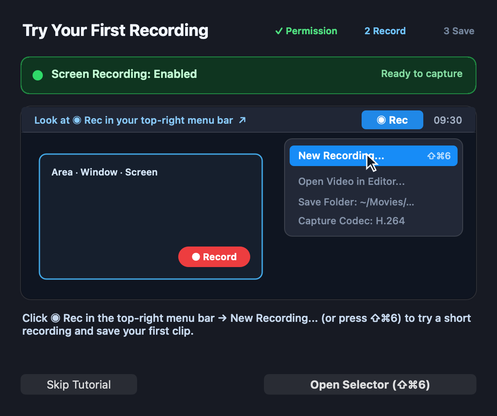
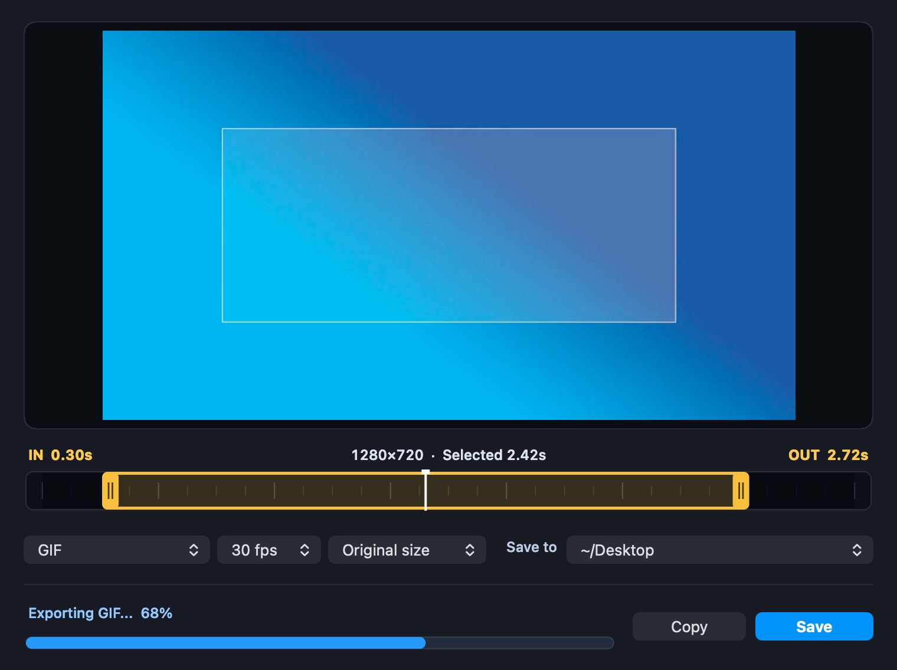

# Quick Screen Recorder

[](LICENSE)
[](https://www.apple.com/macos/)
[](https://www.rust-lang.org/)

[English README](README.md)

Apple の **ScreenCaptureKit**・**AVFoundation / VideoToolbox**・**AppKit** を純 Rust から直接駆動する、macOS 向けの高速・軽量ネイティブ画面録画アプリです。

Electron（Chromium + Node.js）ベースの画面録画ツールと異なり、常駐メモリは数十 MB 台、起動と範囲選択は瞬時、録画中は Apple Silicon のハードウェアエンコーダ（`SCRecordingOutput`）へゼロコピー直結し、GIF / APNG 書き出しも外部依存なしのマルチコア並列処理で高速に完了します。

## スクリーンショット

| 初回セットアップ＆チュートリアル | 範囲・ウィンドウ・画面選択オーバーレイ | Trim & Export エディタ |
|---|---|---|
|  |  |  |

## 特徴

- **初回起動の権限オンボーディング＆アニメーションチュートリアル** — 初回起動時に画面収録権限のライブステータスバナーを表示し、バナー内の **`Open Settings →`** ボタンからワンクリックで「システム設定 > プライバシーとセキュリティ > 画面収録」を開けます。許可・再起動するとステータスがグリーンに変わり、右上メニューバー `◉ Rec` からの試し録画〜書き出し保存までアニメーション付きで 1 回ガイドします（メニューバー **`◉ Rec` → `Quick Start Guide...`** からいつでも再表示可能）。
- **Electron / WebView 不使用の純ネイティブ設計** — AppKit のメニューバー常駐とボーダレス透明オーバーレイにより、軽快に動作します。
- **ハードウェア直結録画 (`SCRecordingOutput`)** — 範囲・単一ウィンドウ・画面全体を H.264 / HEVC でリアルタイムにハードウェアエンコードし、ノンブロッキング停止処理で確実に MP4 を仕上げます。
- **高視認・追従フローティングバー＆直感的なキャプチャ選択オーバーレイ**
  - **選択対象に追従する高視認 2 段フローティングバー**: 暗い背景でも埋もれない明るいリム＋高コントラスト背景＋ドロップシャドウ付き。選択した範囲やウィンドウのすぐ下へ自動で追従し（Dock と重なる場合は上へ退避、全画面時は下端に安全配置）、録画ボタンまでのマウス移動距離を最小化します。
  - **Area（範囲選択）**: 穏やかな 10pt 角丸フレーム、ドラッグ作成、選択範囲内のドラッグ移動、8 方向リサイズ、アスペクト比ロック（`Free` / `16:9` / `16:10` / `4:3` / `3:2` / `1:1` / `9:16`）、`W × H` ピクセル数値入力に対応。
  - **Window（ウィンドウ単体）**: 画面上の任意のウィンドウをクリックするだけで録画対象を切り替え可能（手前に重なった別ウィンドウは映り込みません）。
  - **Screen（画面全体）**: マルチディスプレイ環境で任意のディスプレイを選択可能。
  - **分離された音声設定（前回設定を自動記憶）**: **System Audio**（システム出力音声、デフォルト ON）のトグルと、**Mic**（マイク入力デバイス：`Off` / `System (<既定マイク>)` デフォルト ON / 接続済み各マイク）のドロップダウンを独立配置し、終了後も前回の設定を記憶します。マイク権限は初回録画開始時に macOS 標準ダイアログで自然に要求します。
  - **低 FPS 録画＆インターバル・タイムラプス撮影**: 実時間録画は **`60 / 30 / 15 / 5 / 1 fps`** を選べ（音声対応・エディタも元 FPS に自動追従して軽量パススルーを維持）、さらに **`1f/5s · TL` / `1f/10s · TL` / `1f/30s · TL` / `1f/1m · TL`**（5 秒〜1 分に 1 コマ）のタイムラプス撮影にも対応。待機中 CPU ほぼ 0%・メモリ一定で長時間撮影し、再生しやすい **30 fps** 早送り MP4 を生成します（タイムラプス時は音声を自動オフ、メニューバーに `● TL 00:15 · 3f` と撮影枚数を表示）。
  - **カーソル表示**・**クリック強調表示**もフローティングバーからワンクリックで切り替え。
- **録画後すぐ使える Trim & Export エディタ**
  - **`IN` / `OUT` ブラケット型タイムライン**: 開始地点・終了地点のブラケットと再生ヘッドを直感的にドラッグし、リアルタイムでフレームをプレビュー。
  - **書き出し時の `Mute audio` チェックボックス**: デフォルトで録音した音声が不要だった場合も、MP4 / HEVC / WebM / AV1 書き出し時にワンクリックで音声トラックを除外できます（CLI でも `convert --mute` 対応）。
  - **外部依存ゼロのネイティブ書き出し**: **MP4 (H.264)**、**MP4 (HEVC)**、**GIF**（並列 NeuQuant パレット量子化＋フレーム差分最適化）、**APNG**。
  - **FFmpeg 自動連携（任意）**: システムに `ffmpeg` がある場合は **WebM (VP9)** と **MP4 (AV1)** も自動で選択可能になります。
  - **専用保存フォルダ・最適自動命名＆任意ファイル名編集・プログレスバー**: デフォルト保存先は **`~/Movies/Quick Screen Recorder`**（自動作成）で、エディタの **`Save to`** ドロップダウンまたはメニューバー **`◉ Rec` → `Save Folder`** からいつでも任意のフォルダ（`~/Movies`・`~/Desktop`・`~/Downloads`・`~/Documents` や **`Choose Folder...`** での新規フォルダ作成）へ変更・記憶できます。自動ファイル名は時系列順で並び検索しやすい **`YYYY-MM-DD_HH-MM-SS_Quick-Screen-Recorder`**（ウィンドウ録画時は対象アプリ名も付与）を初期表示し、エディタの **`Name`** 欄で任意の名前にそのまま編集してプログレスバー付きで即保存（または **`Copy`** でクリップボードコピー）できます。
- **プライバシー重視のローカル完結設計**
  - ネットワーク通信・外部テレメトリ送信は一切ありません。
  - **画面ロック・スリープ時の自動停止＆安全保存**: macOS の画面ロック・ユーザー切替・ディスプレイ／システムスリープを検知すると通常録画・タイムラプスを自動停止し、検知時点までの録画をローカル退避先（`Recovered`）へ安全保存した上でエディタで開きます（タイムラプスは各コマの撮影前・書き込み前にもセッションのロック状態を確認します）。
  - 書き出し時に動画コンテナのメタデータを自動除去します。
  - ローカルの速度統計（`stats` サブコマンド）にもファイルパス・ウィンドウ名・個人情報は一切記録しません。

## 動作要件

- **macOS 15.0 (Sequoia) 以降**
- ソースからビルドする場合: **Rust 1.85 以降**
- 任意: WebM / AV1 書き出しを使う場合のみ `ffmpeg`（`brew install ffmpeg`）

## ビルドと起動

```bash
git clone https://github.com/noricha-vr/quick-screen-recorder.git
cd quick-screen-recorder

# Release ビルドと dist/QuickScreenRecorder.app の作成
make bundle

# 起動（メニューバーに「◉ Rec」が表示されます）
open dist/QuickScreenRecorder.app

# アプリケーションフォルダへ配置する場合
cp -R dist/QuickScreenRecorder.app /Applications/
```

初回起動時に **Quick Start** ウィンドウが自動で開き、画面収録権限の確認・システム設定のワンクリック起動・許可後のグリーン確認から、右上メニューバーでの試し録画〜書き出し保存まで順番に案内します。

## 使い方

1. 起動後、初回は **Quick Start** ウィンドウの案内に沿って画面収録権限を有効にします（いつでもメニューバー **`◉ Rec` → `Quick Start Guide...`** から開き直せます）。
2. メニューバーの **`◉ Rec` → `New Recording...`** をクリックするか、グローバルショートカット **`Cmd + Shift + 6`** を押します（`Esc` でキャンセル）。
3. **Area / Window / Screen**、比率、解像度、フレームレート（`60`〜`1 fps` 実時間、または `1f/5s`〜`1f/1m` タイムラプス）、音声、カーソル・クリック強調を選び、**`● Record`** を押して録画を開始します。
4. 録画中はメニューバーに経過秒数（`● 00:08`）が表示されます。メニューの **`Stop Recording`** または **`Cmd + Shift + 6`** で停止します。
5. 自動で開く **Trim & Export** ウィンドウで **`IN` / `OUT`** 範囲、フォーマット、最大幅、**`Save to`** 保存先フォルダ（既定 `~/Movies/Quick Screen Recorder`、メニューバー **`◉ Rec` → `Save Folder`** からも変更可）、必要に応じて **`Name`** ファイル名欄（自動生成 `YYYY-MM-DD_HH-MM-SS_Quick-Screen-Recorder` 等）を調整し、**`Copy`** または **`Save`** を押します。

## ライセンス

[MIT License](LICENSE)
