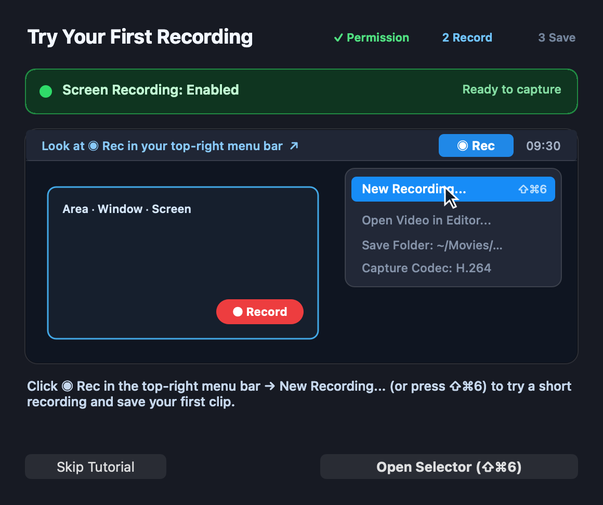
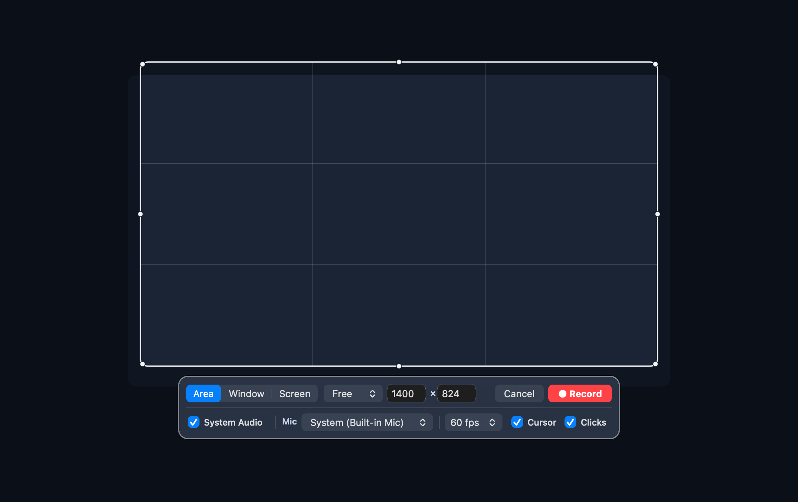
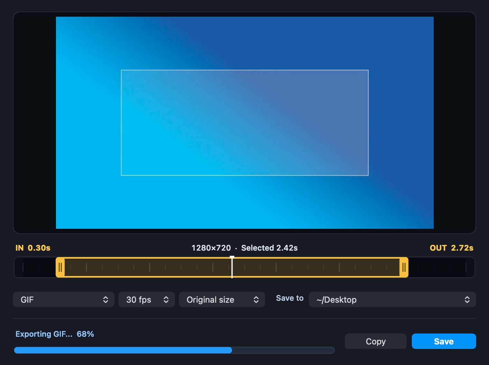

# Quick Screen Recorder

[](LICENSE)
[](https://www.apple.com/macos/)
[](https://www.rust-lang.org/)

[日本語ドキュメント (Japanese)](README.ja.md)

A fast, lightweight native screen recorder for macOS built in pure Rust on top of Apple's **ScreenCaptureKit**, **AVFoundation / VideoToolbox**, and **AppKit**.

Unlike Electron-based recorders that keep a full Chromium runtime resident in memory and rely on single-threaded software post-processing, Quick Screen Recorder runs with a ~20 MB native footprint, encodes H.264 / HEVC directly on Apple Silicon hardware during capture, and exports GIF / APNG in parallel across CPU cores with zero external runtime dependencies.

## Screenshots

| Quick Start & Permission Guide | Region / Window / Screen Selector | Trim & Multi-Format Export Editor |
|---|---|---|
|  |  |  |

## Highlights

- **Guided First-Run Onboarding & Interactive Tutorial** — Opens automatically on first launch with a live Screen Recording permission banner (amber -> green after macOS **Quit & Reopen**), an inline **`Open Settings →`** action right inside the permission banner linking directly to **System Settings > Privacy & Security > Screen & System Audio Recording**, and an animated top-right menu bar walkthrough from your first capture to saved export (reopen anytime via **`◉ Rec` → `Quick Start Guide...`**).
- **Zero Electron / Zero WebView** — Pure Rust + native AppKit status-bar app and borderless overlay. Instant startup and minimal idle memory.
- **Hardware-Direct Recording (`SCRecordingOutput`)** — Streams selected regions, individual windows, or full displays directly to hardware H.264 / HEVC MP4 with near-zero CPU overhead and non-blocking stream teardown.
- **Flexible Capture Selector & High-Contrast Following Toolbar**
  - **Smart Following 2-Row Toolbar**: Automatically docks directly below your selected area or window (flipping above when near the Dock, or floating safely inside fullscreen targets) with an elevated high-contrast frame, crisp rim, and native drop shadow so it stands out over both dark and bright screens.
  - **Area mode**: Subtle macOS-style 10pt rounded selection corners, drag to create, grab inside to reposition, 8-way resize handles, aspect-ratio lock (`Free`, `16:9`, `16:10`, `4:3`, `3:2`, `1:1`, `9:16`), and exact `W × H` pixel input.
  - **Window mode**: Hover and click any on-screen window to switch the capture target on the fly (overlapping windows are excluded automatically during capture).
  - **Screen mode**: Full-display capture across multi-monitor setups.
  - **Split Audio Controls (Persisted)**: Independent **System Audio** toggle (ON by default) and **Mic** input device dropdown (`Off`, `System (<default mic>)` ON by default, or any specific connected microphone), automatically remembered across launches. Microphone access is requested natively on demand when recording with a mic.
  - **Flexible Frame Rates & Interval Timelapse**: Choose real-time capture from **`60 / 30 / 15 / 5 / 1 fps`** (with full audio support and matching default FPS in the Trim & Export editor so low-FPS recordings stay tiny via instant passthrough), or switch to **Interval Timelapse** (**`1f/5s · TL`**, **`1f/10s · TL`**, **`1f/30s · TL`**, **`1f/1m · TL`**) for near-zero idle CPU multi-hour recording automatically assembled into a smooth **30 fps** fast-forward MP4 (audio auto-muted, menu bar shows `● TL MM:SS · Nf`).
  - Toggle **cursor visibility** and **native click highlights** right from the floating bar.
- **Instant Trim & Multi-Format Export Editor**
  - **Dual-bracket `IN` / `OUT` timeline**: Drag rectangular start/end trim brackets or scrub the playhead with live hardware-decoded frame preview.
  - **One-Click `Mute audio` on Export**: Strip audio tracks cleanly from MP4 / HEVC / WebM / AV1 exports (also available in CLI via `convert --mute`) when you captured audio by default and want a silent clip.
  - **Zero-dependency native exports**: **MP4 (H.264)**, **MP4 (HEVC)**, **GIF** (multithreaded NeuQuant global palette + frame-delta bounding-box optimization), and **APNG**.
  - **Optional FFmpeg exports**: Automatically unlocks **WebM (VP9)** and **MP4 (AV1)** when `ffmpeg` is installed on your Mac.
  - **Smart Export Folder, Naming & Real-Time Progress**: Defaults to **`~/Movies/Quick Screen Recorder`** (auto-created) and lets you switch destinations anytime via the **`Save to`** dropdown in the editor or **`Save Folder`** in the `◉ Rec` menu bar (`~/Movies/Quick Screen Recorder`, `~/Movies`, `~/Desktop`, `~/Downloads`, `~/Documents`, or **`Choose Folder...`** with New Folder creation). Auto-names files chronologically for Finder sorting & Spotlight search (`YYYY-MM-DD_HH-MM-SS_Quick-Screen-Recorder`, plus target app name on Window captures) while letting you freely edit the **`Name`** field before clicking **`Save`** (atomic non-overwriting write + live progress bar) or **`Copy`**.
- **Privacy by Design**
  - 100% local execution with **zero network access** and **zero external telemetry**.
  - **Auto-Stop & Save on Lock/Sleep**: Automatically stops active real-time and timelapse recordings as soon as macOS reports screen lock, user switch, or display/system sleep—saving everything captured up to detection safely to local recovery and opening it in the editor (timelapse additionally checks session lock state before capturing and before writing each frame).
  - Container metadata is stripped automatically on export (`setMetadata(None)` / `-map_metadata -1`).
  - Local performance stats (`stats` command) record only format, duration, and encode latency—never file paths, window titles, or personal identifiers.

## Requirements

- **macOS 15.0 (Sequoia) or later** (Apple Silicon or Intel)
- **Rust 1.85+** (`rustup` recommended) for building from source
- Optional: `ffmpeg` (`brew install ffmpeg`) only if you need **WebM (VP9)** or **AV1** export

## Build & Install

```bash
git clone https://github.com/noricha-vr/quick-screen-recorder.git
cd quick-screen-recorder

# Build release .app bundle into dist/QuickScreenRecorder.app
make bundle

# Launch the menu-bar app
open dist/QuickScreenRecorder.app

# Or move to /Applications
cp -R dist/QuickScreenRecorder.app /Applications/
```

On first launch, the **Quick Start** window checks **Screen & System Audio Recording** permission, opens **System Settings** in one click, turns green after macOS **Quit & Reopen**, and guides you through your first recording and export.

## Usage

### Menu Bar & Shortcut (GUI)

1. Launch `QuickScreenRecorder.app` (or run `cargo run --release`). On first launch, follow the **Quick Start** window (or reopen it anytime from **`◉ Rec` → `Quick Start Guide...`**).
2. Click **`◉ Rec` → `New Recording...`** or press **`Cmd + Shift + 6`** anywhere to open the selection overlay (`Esc` cancels).
3. Choose **Area**, **Window**, or **Screen**, adjust aspect ratio / dimensions / frame rate (`60`–`1 fps` real-time or `1f/5s`–`1f/1m` timelapse) / audio / cursor / click highlights, and click **`● Record`**.
4. During recording, the menu bar displays elapsed time (`● 00:08`). Click **`Stop Recording`** in the menu bar or press **`Cmd + Shift + 6`** again to finish.
5. In the **Trim & Export** window, drag the **`IN` / `OUT`** trim brackets if needed, pick your format (**MP4**, **HEVC**, **GIF**, **APNG**, **WebM**, **AV1**), resolution preset, **`Save to`** folder (defaults to `~/Movies/Quick Screen Recorder`, also configurable from **`◉ Rec` → `Save Folder`**), and optionally customize the **`Name`** field (pre-filled with `YYYY-MM-DD_HH-MM-SS_Quick-Screen-Recorder` + window app name when capturing a window), then click **`Copy`** or **`Save`**.

### Command-Line Interface (CLI)

The same binary also provides scriptable CLI subcommands:

```bash
# Check Screen Recording permission and codec availability
quick-screen-recorder doctor

# Open the region selector immediately from terminal
quick-screen-recorder --select

# Open an existing video in the Trim & Export editor
quick-screen-recorder --edit ./demo.mp4

# Headless timed capture (e.g. 5s of a 1280x720 region at 60fps, or 1 fps low-bandwidth)
quick-screen-recorder record --output ./capture.mp4 --duration 5 --region 100,100,1280,720 --fps 60

# Headless interval timelapse (e.g. 1 frame every 60s for 1 hour -> smooth 30fps MP4)
quick-screen-recorder record --output ./timelapse.mp4 --duration 3600 --interval 60

# Fast format conversion & trimming (e.g. MP4 -> optimized 30fps GIF, max width 800px; add --mute to strip audio)
quick-screen-recorder convert --input ./capture.mp4 --output ./clip.gif --format gif --fps 30 --start 0.5 --end 4.0 --max-width 800

# View local-only export/capture latency percentiles
quick-screen-recorder stats
```

## Development

```bash
make check    # cargo fmt --check + cargo clippy (-D warnings) + unit & integration tests
make bundle   # Build release binary and package dist/QuickScreenRecorder.app
```

## License

Released under the [MIT License](LICENSE).
